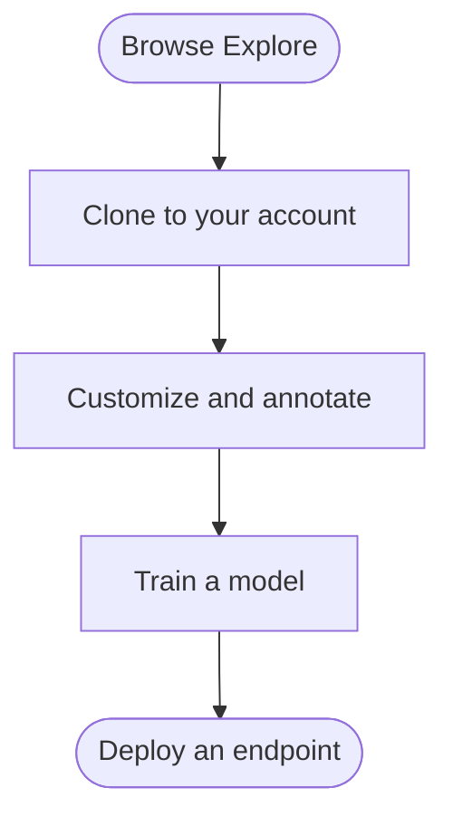
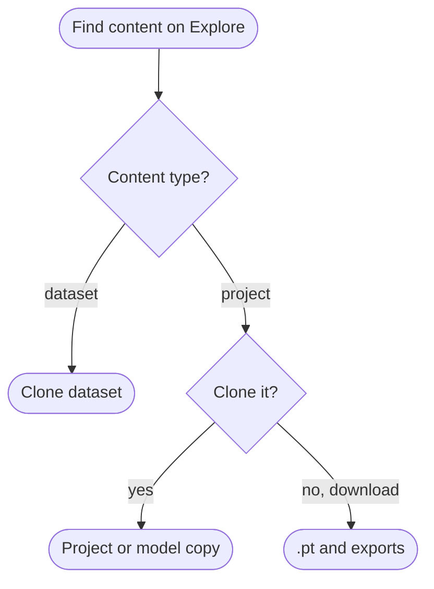
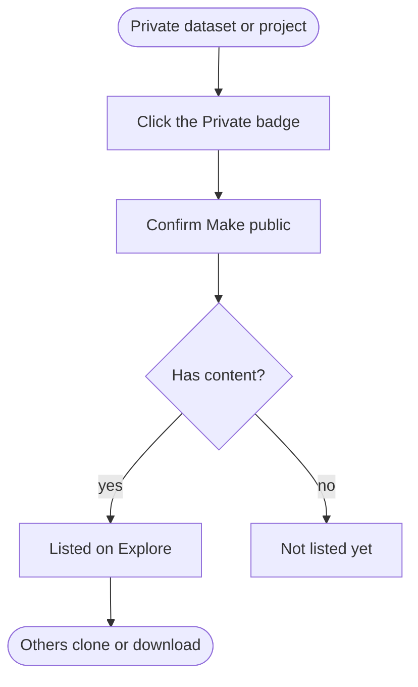

# Explore Datasets, Models, and Projects

The [Ultralytics Platform](https://platform.ultralytics.com) Explore page lists public content from the community. Find [datasets](data/datasets.md) to train on, trained [models](train/models.md) by what they detect, and [projects](train/projects.md) for inspiration and learning. The Explore page is accessible to everyone — even without signing in.

<!-- screenshot -->



!!! info "Anonymous Access"

    The Explore page works without signing in. Signed-out visitors get **Datasets** and **Models** sections in the sidebar listing official `@ultralytics` content, in place of the **Annotate**, **Train**, and **Deployments** sections that hold your own work. Public models can even be tested in the browser from their `Predict` tab. To clone content or create your own, you'll need to sign up.

## Overview

The Explore page features four tabs:

- **Public Datasets**: Community training data with image previews
- **Search Images**: Images from public datasets, and from your own and team datasets when signed in, found by what
  they show
- **Public Models**: Trained models found by what they detect, each with its training images and headline metrics
- **Public Projects**: Complete experiments containing trained models

Only datasets that contain at least one image and projects that contain at least one model appear on Explore, so empty
placeholders never surface in results.

## Browse Content

### Tabs

The Explore page uses a tabbed interface with `Datasets`, `Images`, `Models`, and `Projects` tabs. Each tab has its own search; the Datasets, Models, and Projects tabs also have sort and view mode controls.

| Tab          | Description                                       |
| ------------ | ------------------------------------------------- |
| **Datasets** | Labeled image collections for training (default)  |
| **Images**   | Images found by what they show                    |
| **Models**   | Trained models found by what they detect          |
| **Projects** | Organized model collections with training results |

### Search

Each tab has its own search bar. Results update as you type and the query is kept in the URL as `?q=`, so a search is
easy to bookmark or share.

<!-- screenshot -->

| Tab          | Matched Fields                                                                                           |
| ------------ | -------------------------------------------------------------------------------------------------------- |
| **Datasets** | Name, description, owner username, tags, and class names                                                 |
| **Images**   | What the image shows                                                                                     |
| **Models**   | Model name; the project's name, description, owner username, and tags; and what its training images show |
| **Projects** | Name, description, owner username, and tags                                                              |

On the Datasets tab, datasets that match the fields above come first, followed by datasets whose images match the
search, and their cards show the matching images. Searching an official dataset's name or address (such as `HIT-UAV` or
`hit uav`) puts the official `@ultralytics` dataset above copies that share its name. Before you search, the Images tab
lists one image from each of the newest public datasets. Search it by what images show with
[semantic search](https://www.ultralytics.com/glossary/semantic-search): describe a scene such as `cats on a sofa`. Click any image to open a side panel with its annotations, source dataset, class counts, and license, followed by up to
24 similar images, including ones from the same dataset, when you are signed in; click one to open it in the panel. On
narrow screens such as phones, the image opens full size instead.

To search by a photo instead, click the search-by-image icon in the Datasets, Images, or Models search bar, or drop an
image onto the page. iPhone HEIC photos work too: the browser converts them to JPEG before searching. The Images tab
shows images like it, each with its similarity score, the Datasets tab shows public datasets containing similar images,
with those images on their cards, and the Models tab shows models trained on similar images. Filters, and sorting on the
Datasets and Models tabs, still apply, and switching between these three tabs keeps the photo. The photo is searched,
not saved, and stays out of the URL; the search bar shows it until you click **Close**, type a search, or open the
Projects tab.

### Find Models by What They Detect

On the Models tab, describe what you need to detect, such as `hard hat` or `aerial drones`, to find public trained
models even when no model or project name contains your words.

<!-- screenshot -->

Results are ranked in three tiers:

1. Official `@ultralytics` models whose name or project matches, such as YOLO26 models for `yolo26`
2. Models whose name or project matches the search
3. Models trained on public datasets whose images match the search, best match first

To keep repeated runs and copies from filling the page, the tab lists one model per training dataset (or per project for
models without one), while official `@ultralytics` models each keep their own card. It leaves out cloned models and
models that haven't finished training; the training dataset's [Models tab](data/datasets.md#models-tab) lists the other
models trained on it. Before you search, the tab lists models trained on public datasets, newest first. Models without a
public training dataset, such as uploaded `.pt` files, are found by their model or project name only.

Click a card to open the model, then test it from its `Predict` tab, [clone it](#clone-model) and
[deploy](deploy/endpoints.md) your copy, or [download it](#download-model).

### Sort and Filter

The dropdown in the toolbar holds sort options on the Datasets, Models, and Projects tabs and filters on all four tabs.
The Models tab sorts by **Relevance** or **Created** only:

| Sort Option             | Description                                                                               |
| ----------------------- | ----------------------------------------------------------------------------------------- |
| **Relevance**           | Datasets and Models tab default: best search matches first, newest first without a search |
| **Stars**               | Community star count (descending)                                                         |
| **Created**             | Creation date, newest or oldest first; newest is the Projects tab default                 |
| **Name**                | Alphabetical, ascending or descending                                                     |
| **Images** / **Models** | Image count (datasets) or model count (projects), most or fewest first                    |

| Filter          | Tabs                       | Availability   | Description                                                                                      |
| --------------- | -------------------------- | -------------- | ------------------------------------------------------------------------------------------------ |
| **Task**        | Datasets, Images, Models   | Everyone       | Show only content for the selected tasks (detect, segment, semantic, depth, classify, pose, obb) |
| **My starred**  | Datasets, Images, Projects | Signed in only | Show only datasets or projects you have starred, or images from those datasets                   |
| **Image count** | Datasets                   | Everyone       | Show only datasets with **Under 1K**, **1K – 10K**, **10K – 100K**, or **100K+** images          |
| **License**     | Datasets, Images, Projects | Everyone       | Show only datasets (or images from them) or projects published under the selected licenses       |

Sorting and filtering are also stored in the URL (`dsort`, `msort`, `psort`, `task`, `starred`, `imageCount`,
`license`, and `plicense`), so the browser back button restores the previous result list.

!!! note "Sorting by Stars"

    The **Stars** sort shows only datasets with at least one star, so unrated datasets are hidden while it is active.

### View Modes

On the Datasets and Projects tabs, toggle between three view modes for browsing; the Models tab offers **Cards** and
**Compact**:

| Mode        | Description                                      |
| ----------- | ------------------------------------------------ |
| **Cards**   | Grid of preview cards with thumbnails            |
| **Compact** | Smaller cards in a responsive grid (2-3 columns) |
| **Table**   | Table with sortable columns                      |

All three views load more results as you scroll. Table view moves sorting from the dropdown to sortable column headers
and keeps the filters in the dropdown.

## Content Cards

Each item displays:

<!-- screenshot -->

=== "Project Cards"

    | Element         | Description                                            |
    | --------------- | ------------------------------------------------------ |
    | **Icon**        | Project icon with custom color, letter, or cover image |
    | **Name**        | Project title                                          |
    | **Creator**     | Author avatar and username                             |
    | **Description** | Short project description                              |
    | **Star Count**  | Number of community stars (shown when above zero)      |
    | **Model Count** | Number of models in the project                        |
    | **Size**        | Total storage used by the project's model files        |
    | **Updated**     | Date the project last changed                          |
    | **Model Tags**  | Names of the first few models in the project           |
    | **Tags**        | Project tags                                           |

=== "Dataset Cards"

    | Element         | Description                                                   |
    | --------------- | ------------------------------------------------------------- |
    | **Thumbnails**  | Up to four preview images with their annotations drawn on top |
    | **Name**        | Dataset title                                                 |
    | **Creator**     | Author avatar and username                                    |
    | **Task Badge**  | YOLO task type (detect, segment, etc.)                        |
    | **Image Count** | Number of images, overlaid on the thumbnail strip             |
    | **Star Count**  | Number of community stars (shown when above zero)             |
    | **Class Count** | Number of classes defined in the dataset                      |
    | **Size**        | Total storage used by the dataset                             |
    | **Updated**     | Date the dataset last changed                                 |
    | **Class Names** | First few class names as badges                               |
    | **Tags**        | Dataset tags                                                  |
    | **Split Bar**   | Relative sizes of the train, val, and test splits             |

=== "Model Cards"

    | Element             | Description                                                                                                                                    |
    | ------------------- | ---------------------------------------------------------------------------------------------------------------------------------------------- |
    | **Training Images** | Images from the model's public training dataset with their labels and its image count, or its project's cover image or icon when there is none |
    | **Name**            | Model name                                                                                                                                     |
    | **Task Badge**      | YOLO task type (detect, segment, etc.)                                                                                                         |
    | **Owner / Project** | Owner username and the project that holds the model                                                                                            |
    | **Metrics**         | The task's first two metrics, such as mAP50 and mAP50-95 for detection or top-1 and top-5 accuracy for classification                          |
    | **Star Count**      | Number of community stars (shown when above zero)                                                                                              |
    | **Epochs**          | Number of training epochs                                                                                                                      |
    | **Size**            | Model file size                                                                                                                                |
    | **Dataset**         | Name of the public dataset the model was trained on                                                                                            |
    | **Class Names**     | First four class names the model detects as badges, then how many more                                                                         |

## Use Public Content



### Clone Dataset

Use a public dataset for your training:

1. Click on the dataset to open its detail page
2. Click `Clone Dataset`
3. Review the destination workspace, name, visibility, and license
4. Click `Clone Dataset` to confirm

<!-- screenshot -->

!!! note "Cloned Dataset Properties"

    - The clone dialog lets you review the destination, name, visibility, and license
    - Public datasets stay public by default unless the workspace's [default dataset visibility](account/settings.md#default-visibility) is Private
    - A copyleft source license is carried over and locked, so the clone keeps the terms it was published under
    - For a new dataset, the clone dialog blocks a URL already used in the target workspace until you choose another
    - You can modify classes, annotations, and splits
    - Changes don't affect the original dataset
    - Image files are reused rather than copied, but the clone still counts toward the destination workspace's storage quota

See [Datasets](data/datasets.md) for managing and annotating your cloned dataset.

### Download Model

Download a public model:

1. Open the model from the [Models tab](#find-models-by-what-they-detect) or from its project
2. Click the **download icon** to download its PyTorch `.pt` weights
3. Open the **Export** tab to download any completed exports that are available

You can also use the model for inference or as a starting point for [fine-tuning](https://www.ultralytics.com/glossary/fine-tuning):

```bash
# Use a downloaded model for inference
yolo predict model=path/to/downloaded-model.pt source=image.jpg

# Fine-tune on your own dataset
yolo train model=path/to/downloaded-model.pt data=my-dataset.yaml epochs=50
```

### Clone Model

Clone a public model to one of your projects:

1. Open the model from the [Models tab](#find-models-by-what-they-detect) or from its project
2. Click `Clone Model`
3. Select a **Project**, or choose **New Project** to create one
4. Optionally, rename the model
5. Review the source model summary, then click `Clone Model` to confirm

<!-- screenshot -->

!!! note "Clone vs Download"

    **Clone** copies the model to a project on the Platform for further training or deployment. **Download** saves the model file to your local machine.

### Clone Project

Copy a public project to your workspace:

1. Click on the project to open its detail page
2. Click `Clone Project`
3. Review the destination, name, visibility, and license, then click `Clone Project`

<!-- screenshot -->

The cloned project includes completed models that have model files. Deployments and exports are not copied. The models count toward your workspace's [model limit](train/projects.md#how-many-models-can-a-project-contain). Its default visibility follows the same workspace rules as dataset cloning.

See [Projects](train/projects.md) for organizing models in your project.

## Official Ultralytics Content

Official `@ultralytics` projects are pinned to the top of the Explore Projects tab, and their models lead [matching Models tab searches](#find-models-by-what-they-detect): [YOLO26](https://platform.ultralytics.com/ultralytics/yolo26), [YOLO11](https://platform.ultralytics.com/ultralytics/yolo11), [YOLOv8](https://platform.ultralytics.com/ultralytics/yolov8), and [YOLOv5](https://platform.ultralytics.com/ultralytics/yolov5). Open a project to see its current models and supported tasks.

Official datasets include benchmark datasets like [coco8](https://platform.ultralytics.com/ultralytics/datasets/coco8) (8-image COCO subset), [VOC](https://platform.ultralytics.com/ultralytics/datasets/voc), [african-wildlife](https://platform.ultralytics.com/ultralytics/datasets/african-wildlife), [dota8](https://platform.ultralytics.com/ultralytics/datasets/dota8), and other commonly used [computer vision datasets](../datasets/index.md).

!!! tip "Quick Start with Official Models"

    The fastest way to get started is to fine-tune an official pretrained model on your own dataset — no cloning required:

    1. Upload your dataset in [supported formats](data/datasets.md#preparing-your-dataset)
    2. Click **New Model** on the dataset page
    3. Choose a YOLO26 model from the **Official** tab of the base model selector and start training

## User Profiles

Click on a creator's username to view their public profile at `platform.ultralytics.com/{username}`. Public profiles show:

<!-- screenshot -->

| Section       | Content                                           |
| ------------- | ------------------------------------------------- |
| **Identity**  | Avatar, display name, `@username`, and plan badge |
| **Bio**       | User description and company                      |
| **Links**     | Social profiles                                   |
| **Followers** | Follower count                                    |
| **Datasets**  | Public datasets (default tab)                     |
| **Projects**  | Public projects with models                       |

The Datasets and Projects tabs use the same search, sort, and view controls as the Explore page, without the **Relevance** sort.

### Follow Users

Click the **Follow** button on any user's profile to follow or unfollow them. Follower counts are displayed on public
profiles. The **Share** button next to it copies a link or opens a pre-filled social post.

## Make Your Content Public

Make your work available to the community. Public content is visible to everyone, including users who aren't signed in. Explore lists public datasets that contain at least one image and public projects that contain at least one model, so an empty dataset or a project with no models stays off the Explore page until you add content to it. Models follow the visibility of the project that holds them and have no separate badge; a public project's trained models, except clones, are listed on the [Models tab](#find-models-by-what-they-detect).



### Make Dataset Public

1. Go to your dataset
2. Click the **Private** visibility badge in the top navigation bar
3. Review the warning and click **Make public**

### Make Project Public

1. Go to your project
2. Click the **Private** visibility badge in the top navigation bar
3. Review the warning and click **Make public**

!!! tip "Quality Content"

    Before making content public:

    - Add a clear, descriptive name and description
    - Define class names in the dataset settings
    - Verify data quality and annotation accuracy
    - Test model performance and include training metrics

!!! warning "Public Content Visibility"

    Public content is visible to **everyone on the internet**, including anonymous users. Make sure your dataset doesn't contain sensitive, private, or copyrighted data before making it public. You can change visibility back to private at any time.

## Guidelines

When contributing public content:

### Do

- Provide useful, high-quality content
- Write clear descriptions
- Include relevant metadata
- Respond to questions
- Credit data sources

### Don't

- Upload sensitive/private data
- Violate copyrights
- Upload inappropriate content
- Spam low-quality content
- Misrepresent performance

## Share Content

Click the **Share** button on any public profile, project, model, or dataset. On desktop it opens a menu with **Share on
X**, **Share on LinkedIn**, **Copy link**, and — for embeddable resources — **Copy embed code**. The social options open
a pre-filled post. On mobile it hands off to your device's native share sheet.

## Embed Widgets

Public content can be embedded in external websites using embed URLs:

| Content | Embed URL Pattern                                             |
| ------- | ------------------------------------------------------------- |
| Project | `platform.ultralytics.com/embed/{username}/{project}`         |
| Model   | `platform.ultralytics.com/embed/{username}/{project}/{model}` |
| Dataset | `platform.ultralytics.com/embed/{username}/datasets/{slug}`   |

Use these URLs in an `<iframe>` to embed public preview cards for projects, models, or datasets. Each card links to the full resource on Platform. **Copy embed code** in the Share menu produces the `<iframe>` snippet for you.

## Public Content URLs

Public content on the platform uses clean, shareable URLs:

| Content  | URL Pattern                                             | Example                                               |
| -------- | ------------------------------------------------------- | ----------------------------------------------------- |
| Profile  | `platform.ultralytics.com/{username}`                   | `platform.ultralytics.com/ultralytics`                |
| Datasets | `platform.ultralytics.com/{username}/datasets`          | `platform.ultralytics.com/ultralytics/datasets`       |
| Dataset  | `platform.ultralytics.com/{username}/datasets/{slug}`   | `platform.ultralytics.com/ultralytics/datasets/coco8` |
| Project  | `platform.ultralytics.com/{username}/{project}`         | `platform.ultralytics.com/ultralytics/yolo26`         |
| Model    | `platform.ultralytics.com/{username}/{project}/{model}` | `platform.ultralytics.com/ultralytics/yolo26/yolo26n` |

!!! tip "Shareable Links"

    You can share any public content URL directly. Recipients can view the content without signing in. To clone or download, they'll need an account.

## FAQ

### Can I use public content commercially?

Check the license shown on the individual project, model, or dataset. Usage rights depend on that resource's license; contact the creator when the license does not grant the rights you need.

### How do I report inappropriate content?

To report inappropriate content:

1. Navigate to the public page containing the content (project or dataset), if accessible
2. Open the **Help** page from the sidebar
3. Select **General** as the feedback type
4. Describe the content and the issue, including a link to the page
5. Submit the report

If the content is no longer accessible, use the **Help** page from any page and include as much detail as possible (URL, username, or description).

### Can I make public content private again?

Yes, you can change visibility anytime:

1. Open the project or dataset
2. Click the **Public** visibility badge in the top navigation bar
3. The resource changes to private immediately

Existing clones are not affected.
